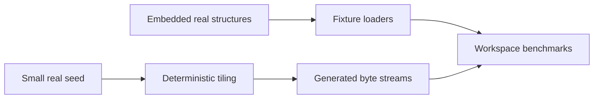

# molframe-bench

Shared benchmark fixtures and generators for the MolFrame workspace.

This internal crate keeps performance experiments reproducible without making every crate maintain its own fixture machinery.



Real samples provide common PDB, mmCIF, BinaryCIF, and chemistry fixtures.

For workloads larger than anything reasonable to commit to the repository, the synthetic layer tiles a real structure and can emit format text incrementally. Large-input benchmarks therefore do not require large repository assets or network downloads.

This crate is benchmark infrastructure and is not published as part of the public API.

## Scale sweep

`benches/scale` is a declarative harness for scaling studies: each case is a
registry entry naming an axis (atoms, frames, structures), the tiers it runs
at (1e3 to 1e7 atoms) and a function. Inputs come from deterministic
generators in `src/scale` (uniform clouds, chains, rotated copies, frame
ensembles), so no data is downloaded or committed.

```bash
cargo bench -p molframe-bench --bench scale -- \
    --filter spatial --max-tier large --workers 1,4,18 --budget-secs 60
```

Output is TSV on stdout: time, items per second, peak heap above baseline,
allocation count and a bit-exact checksum per case, tier and worker count.
`# exponent` lines give the log-log scaling exponent per case. A
`# NONDETERMINISTIC` line is emitted when a checksum differs between worker
counts. A tier is skipped when the previous time, extrapolated linearly, would
exceed the budget.
